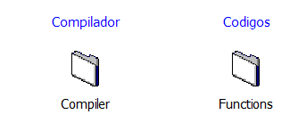

# Rotinas em C e Fortran para PSCAD e ATPDraw

Este repositório reúne rotinas em C, as interfaces Fortran usadas para chamá-las e um projeto de teste do PSCAD (`Ccases.pscx`). A documentação separa o que os fontes incluídos fazem do que o projeto de teste chama.

## O que fazem os fontes

- `codigos.c` implementa uma portadora triangular, a transformada de Clarke, os comandos lógicos das chaves pares e ímpares do GCSC e um distúrbio de tensão e frequência.
- `compilador.f` contém as rotinas `AUX_*` que passam os dados entre o Fortran do PSCAD e as funções em C. A interface da portadora triangular foi alinhada com a função C e recebe cinco argumentos: inclinação, deslocamento, período, tempo e saída.

Em `codigos.c`, a portadora varia de 0 a 1 e é ajustada por inclinação e deslocamento. A transformada de Clarke separa as componentes alfa, beta e de sequência zero. Os controles do GCSC produzem um sinal lógico (0 ou 1) conforme a corrente e as condições angulares recebidas. A rotina de distúrbio altera a tensão de referência e a frequência quando o sinal de entrada supera o limite configurado; sem esse evento, mantém a tensão de referência e 60 Hz.

## Blocos de teste em `Ccases.pscx`

- `test_Csub`: o desenho indica saída igual a seis vezes a entrada e chama uma subrotina C.
- `test_Cfun`: o desenho indica saída igual a duas vezes a entrada e chama uma função C.
- `test_cblck_one`: testa um bloco C com uma posição de armazenamento real e envia o valor armazenado para a saída.
- `test_cblck_two`: testa um bloco C ligado a um ramo entre A e B, com resistência padrão de 1 ohm; o desenho identifica a saída como a tensão do ramo em `t-dt`.
- Na página principal também há chamadas `AUX_DIODE`, `AUX_DIODEN`, `AUX_TENREAl` e `AUX_VINTEREAL`. O projeto mostra quais rotinas esses blocos chamam, mas a lógica interna delas não está documentada nos arquivos incluídos.

## Caminhos dos arquivos no PSCAD

Os blocos **Compilador** e **Códigos** mostrados abaixo representam os arquivos-fonte usados pelo projeto. Ao abrir o `.pscx` em outra pasta ou computador, abra as propriedades de cada bloco e ajuste o campo `filepath` para a localização correta no seu disco:

| Bloco no desenho | Arquivo a selecionar |
| --- | --- |
| **Compilador** (`Compiler`) | Fonte Fortran, extensão `.f` |
| **Códigos** (`Functions`) | Fonte C, extensão `.c` |

O projeto guarda os caminhos locais do computador em que foi criado; por isso, o PSCAD pode continuar procurando os fontes na pasta antiga.

Neste repositório os fontes estão nomeados `compilador.f` e `codigos.c`. Porém, `Ccases.pscx` ainda referencia `al.gf.f` e `POpqa.c` em caminhos locais; esses dois arquivos não estão incluídos aqui. Os fontes do repositório implementam outro conjunto de rotinas, então mudar apenas o caminho dos blocos para eles não basta para reproduzir essa simulação. Para executar o caso como foi montado, é preciso ter as fontes que o projeto referencia ou adaptar o projeto e o código para que usem o mesmo conjunto de funções.
